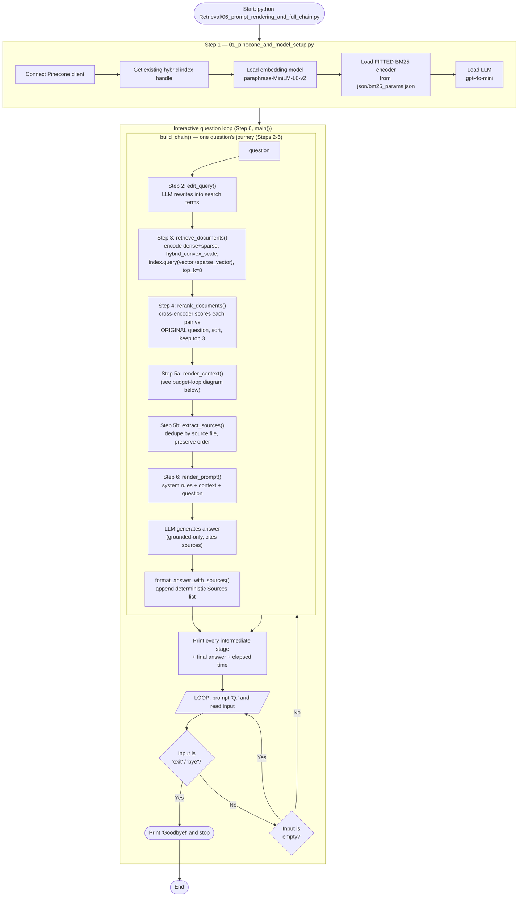

# Hybrid Retrieval RAG — Retrieval (Query-Time) Pipeline

> Source folder: `Retrieval/` (six numbered scripts, run in order 01 → 06;
> `06_prompt_rendering_and_full_chain.py` is the entry point that wires
> 01–05 together and generates the final grounded answer)
> Companion docs: [README.md](README.md), [upsert.md](upsert.md) (the
> ingestion pipeline that must run first so there is data here to retrieve)
> Reference this was modelled on:
> [`ApplianceComunicationSystem/Retrival/`](../../miniProj/ApplianceComunicationSystem/Retrival/)

## Homework mapping

This pipeline implements the five requested retrieval stages, in the order
they actually execute:

| Homework item | Script | Function |
|---|---|---|
| Query editing | `02_query_editing.py` | `edit_query()` |
| Retrieving | `03_hybrid_retrieval.py` | `retrieve_documents()` |
| Re-ranking | `04_reranking.py` | `rerank_documents()` |
| Build Context | `05_context_building.py` | `render_context()`, `extract_sources()` |
| Prompt Rendering | `06_prompt_rendering_and_full_chain.py` | `render_prompt()` |

`01_pinecone_and_model_setup.py` is the connection step every other stage
depends on (not itself one of the five homework items). `06` also wires
Steps 2–5 into one LangChain **LCEL** chain and generates the final grounded
answer, so the rendered prompt doesn't just sit unused — the same file that
renders it is the one that completes the pipeline end to end.

Unlike the appliance-manual reference (`ApplianceComunicationSystem/Retrival/`),
there is **no prefiltering/metadata-filter stage** here: the loan corpus is a
flat folder of `.txt` files with no per-document catalog (no model/
product_type/document_type fields), so `edit_query()` only rewrites the
question — it doesn't also extract a structured filter.

## What this pipeline does, in one paragraph

Six scripts turn one user question into a grounded, cited loan-product
answer. Step 1 connects to the already-populated hybrid Pinecone index, the
dense embedding model, the fitted BM25 encoder, and the LLM. Step 2 rewrites
the question into a cleaner search query with an LLM call. Step 3 embeds
that edited query into both a dense vector and a BM25 sparse vector, scales
them with `hybrid_convex_scale`, and runs one hybrid search against
Pinecone. Step 4 reranks those candidates against the *original* question
with a cross-encoder and keeps only the top 3. Step 5 renders the top
reranked chunks into a single prompt-ready context block plus a
deduplicated source list. Step 6 renders the final system+context+question
prompt, wires Steps 2–5 into one inspectable LangChain chain, feeds the
prompt to the LLM under strict grounding rules, and appends the source list
to the answer — then loops, asking the user for another question until they
type `exit` or `bye`.

---

## Step 1 — `01_pinecone_and_model_setup.py` — Connect to everything

**Purpose:** get handles to the four resources every later stage needs: the
existing hybrid Pinecone index, the dense embedding model, the *fitted* BM25
encoder, and the chat LLM. Creates nothing — it assumes
`Upsert/07_upsert_to_pinecone.py` has already run.

**Logic, plainly:**
1. `get_pinecone_client()` — connect to Pinecone with the API key from
   `keys.py`/`.env`.
2. `get_index()` — return a handle to the `vector-loan-hybrid` index (same
   name the Upsert pipeline created). If it doesn't exist yet, Pinecone
   itself raises the error here.
3. `get_embedding_model()` — load `paraphrase-MiniLM-L6-v2`, the **same**
   model used to embed the stored chunks, so queries land in the same
   vector space as the documents.
4. `load_bm25_encoder()` — load the encoder fitted and saved by
   `Upsert/05_bm25_sparse_encoding.py` from `json/bm25_params.json`. Loading
   this exact encoder (rather than fitting a new one) is what keeps sparse
   query vectors aligned with the sparse vectors already stored in Pinecone.
5. `get_llm()` — return a `ChatOpenAI("gpt-4o-mini", temperature=0)` client,
   reused for query editing (Step 2) and final answer generation (Step 6).

`connect_everything()` bundles all four into one call:
`(pc, index, embedding_model, bm25, llm)`.

**In / Out:** No input. Output: `(pc, index, embedding_model, bm25, llm)`
handles consumed by every downstream step.

---

## Step 2 — `02_query_editing.py` — "Query editing"

**Purpose:** one small LLM call that rewrites the user's informal question
into a clearer search query before Step 3 embeds it — both the dense and
BM25-sparse signals benefit from this same edited text.

**Logic, plainly:**
1. Send the question to the LLM with a system prompt asking for a search-
   query rewrite: same intent, informal wording expanded into loan-document
   terminology (e.g. "money against my house" → "loan against property,
   secured loan using residential property as collateral").
2. Structured output (`EditedQueryOutput` Pydantic model) guarantees the
   reply parses as a single clean string, never free-form chatter.
3. Explicit rules given to the LLM: never answer the question, never add a
   loan product or claim that wasn't in the original question, keep it to
   one sentence.

**In / Out:** In: the raw user question + the LLM. Out: `edited_query` (str),
consumed by Step 3.

---

## Step 3 — `03_hybrid_retrieval.py` — "Retrieving"

**Purpose:** embed the edited query into both a dense and a BM25 sparse
vector, combine them, and run one hybrid similarity search against
Pinecone.

**Logic, plainly:**
1. `encode_dense_query()` — embed `edited_query` with the same dense model
   used to embed the stored chunks (`normalize_embeddings=True`).
2. `encode_sparse_query()` — encode `edited_query` with the *loaded* BM25
   encoder from Step 1 (`bm25.encode_queries(...)`) — never a freshly-fit
   one, or the sparse indices wouldn't line up with what's stored.
3. `encode_hybrid_query(alpha=0.5)` — scales both vectors via
   `hybrid_convex_scale`:
   ```
   scaled_dense  = dense_vector  × alpha
   scaled_sparse = sparse_vector × (1 − alpha)
   ```
4. `retrieve_documents()` — calls `index.query(vector=hybrid_dense,
   sparse_vector=hybrid_sparse, top_k=8, include_metadata=True)` and
   reshapes Pinecone's `ScoredVector` matches into plain dicts:
   `{id, text, source, score, rank}`.

| Alpha value | Effect |
|---|---|
| `alpha = 0` | Pure sparse (BM25/keyword) search |
| `alpha = 0.5` (default) | Equal weight — dense and sparse each scaled by 0.5 |
| `alpha = 1` | Pure dense (semantic) search |

**In / Out:** In: `edited_query`, `index`, `embedding_model`, `bm25`. Out: a
list of up to 8 candidate chunk dicts, ranked by hybrid similarity score.

---

## Step 4 — `04_reranking.py` — "Re-ranking"

**Purpose:** reorder Step 3's candidates against the **original** user
question (not the edited query) with a Cross-Encoder, which — unlike the
vector search in Step 3 — scores the question and chunk **jointly**, so
it's more accurate at judging true relevance.

**Logic, plainly:**
1. Score every `(original_question, candidate_text)` pair with
   `cross-encoder/ms-marco-MiniLM-L-6-v2`.
2. Sort all candidates by that score, best first.
3. Keep only the **top 3** (`top_k=3`) — everything else is dropped and
   printed as `[drop]` so you can see exactly which candidates survived.

**Why the ORIGINAL question, not `edited_query`?** The edited query is
optimized for *recall* (cast a wide net across dense+sparse search in Step
3); reranking is optimized for *precision* against what the user actually
typed — mirroring the appliance-manual reference exactly.

**In / Out:** In: `question` (original), Step 3's candidate list, the
cross-encoder. Out: `reranked_documents` (top 3, each stamped with a
`cross_encoder_score`).

---

## Step 5 — `05_context_building.py` — "Build Context"

**Purpose:** turn the top reranked chunks into what the LLM actually sees,
plus a citation list that doesn't depend on the LLM repeating sources
correctly.

### 5a. `render_context()`
- Concatenates the reranked chunks into one text block, each chunk prefixed
  with a header: `[Source N] <filename> (retrieval_score=..., rerank_score=...)`.
- **Character-budget loop:** walks the reranked chunks in order, keeping a
  running `total_chars` count against a `max_chars=1600` budget. Stops
  adding chunks once the budget is exhausted; truncates the last chunk that
  doesn't fully fit rather than skipping it.

### 5b. `extract_sources()`
- Walks the reranked chunks and collects deduplicated `{source,
  source_name}` pairs (by file path), preserving first-seen order (i.e.
  strongest match first).
- Exists so the final "Sources:" list is always accurate, independent of
  whether the LLM's own answer text faithfully repeats every filename.

**In / Out:** In: `reranked_documents` from Step 4. Out: `rendered_context`
(str), `sources` (list of dicts).

---

## Step 6 — `06_prompt_rendering_and_full_chain.py` — "Prompt Rendering" + wire it all together

**Purpose:** render the final answer-generation prompt, then assemble Steps
2–5 into one LangChain **LCEL** chain and run it end to end.

**Logic, plainly:**
1. `render_prompt(question, rendered_context)` builds a 3-message prompt:
   - system: strict grounding rules (`_ANSWER_SYSTEM_PROMPT` — answer only
     from context, never invent specific rates/fees/tenors, say so if
     evidence is missing, don't blend guidance across products without
     flagging it, prefer short bullet points, never offer to take an
     action).
   - system: `"Context:\n{rendered_context}"`.
   - human: `{question}`.
2. `build_chain()` assembles the full pipeline with
   `RunnablePassthrough.assign(...)`, chained six times so that **every**
   intermediate value survives into the final result dict (not just the
   final answer) — `edited_query`, `retrieved_documents`,
   `reranked_documents`, `rendered_context`, `sources`, `prompt`, `answer`.
   ```
   question
     -> edited_query        (Step 2: edit_query)
     -> retrieved_documents  (Step 3: retrieve_documents)
     -> reranked_documents   (Step 4: rerank_documents, scored vs ORIGINAL question)
     -> rendered_context     (Step 5a: render_context)
     -> sources               (Step 5b: extract_sources)
     -> prompt                (Step 6: render_prompt)
     -> answer                (llm.invoke(prompt).content)
   ```
3. `format_answer_with_sources()` appends the deterministic `sources` list
   (not the LLM's own text) under the LLM's answer.
4. `demo_intermediate_output()` runs one question through the chain and
   prints every intermediate value in order — this is what makes the
   pipeline inspectable end to end rather than one opaque call.
5. `main()`:
   - Connects everything (Step 1), builds the chain, builds the
     cross-encoder (Step 4).
   - **Interactive loop:** prompts `Q:`, reads one question at a time.
     - Empty input → re-prompt without calling the chain.
     - `"exit"` or `"bye"` (case-insensitive) → print `"Goodbye!"` and break
       out of the loop, ending the program.
     - Otherwise → run the full chain via `demo_intermediate_output()`, time
       it, print every stage + the elapsed seconds, then loop back and ask
       again.

**In / Out:** In: a live keyboard question from the user each iteration.
Out: every intermediate stage value + a grounded, cited answer printed to
the console, repeated until the user exits.

> `main.py` at the project root calls `build_chain()` +
> `demo_intermediate_output()` directly on one demo question instead of
> `main()`'s interactive loop, so `python main.py` still finishes on its own
> without waiting on keyboard input. Run
> `python Retrieval/06_prompt_rendering_and_full_chain.py` yourself for the
> interactive Q&A experience.

---

## End-to-end flow diagram



### Context-budget loop (inside Step 5a, `render_context`)

The only loop with real branching logic — worth calling out on its own
since it decides which of the reranked chunks the LLM actually sees.

```mermaid
flowchart TD
    Start(["render_context(reranked_documents, max_chars=1600)"]) --> R1[total_chars = 0, parts = []]
    R1 --> R2[/"LOOP: for each reranked chunk, best-first"/]
    R2 --> R3[Build header + chunk block<br/>Source N, filename, scores]
    R3 --> R4{remaining budget<br/>= max_chars - total_chars<br/>&lt;= 0 ?}
    R4 -- Yes --> R7(["Stop — budget exhausted,<br/>return joined parts"])
    R4 -- No --> R5{block longer than<br/>remaining budget?}
    R5 -- Yes --> R6[Truncate block to fit<br/>remaining budget]
    R5 -- No --> R6b[Keep block as-is]
    R6 --> R8[Append block to parts,<br/>add its length to total_chars]
    R6b --> R8
    R8 --> R2
    R2 -- all chunks processed --> R9(["Return parts joined with<br/>'---' separators"])
```

**Reading the loops:**
- **The interactive question loop** (Step 6, `main()`) is the outer loop of
  the whole program — it keeps the process alive, running the full chain
  once per typed question, and only exits on `"exit"`/`"bye"`.
- **The context-budget loop** (Step 5a) is the one place with real
  per-iteration branching: for every reranked chunk it decides whether the
  remaining character budget is already exhausted (stop), the chunk needs
  truncating to fit, or it fits as-is — before moving to the next chunk.
- Everything else in Steps 2–5b (query editing, hybrid encoding, reranking
  score assignment, source de-duplication) is a straight-line pass over a
  small, fixed list (≤8 candidates), not a loop worth diagramming
  separately.
