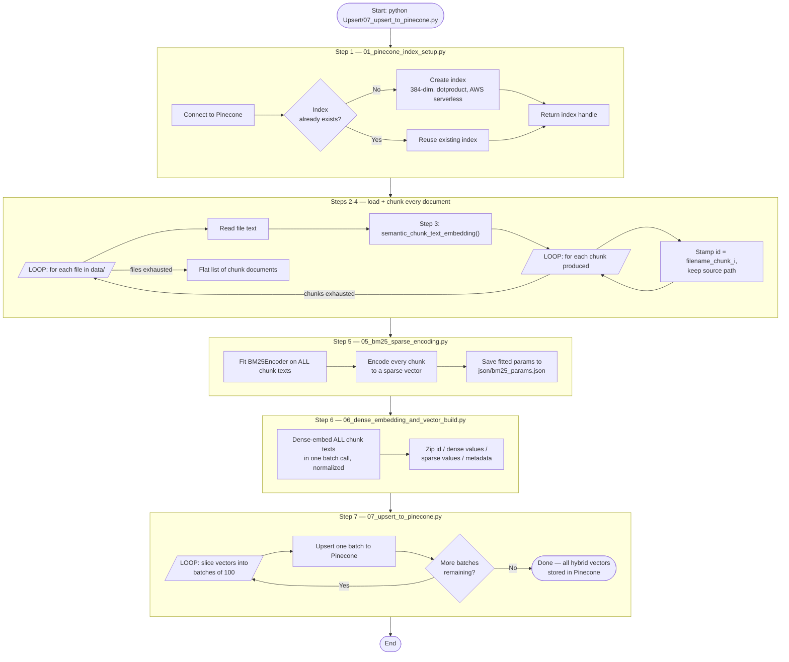

# Hybrid Retrieval RAG — Upsert (Ingestion) Pipeline

> Source folder: `Upsert/` (seven numbered scripts, run in order 01 → 07;
> `07_upsert_to_pinecone.py` is the entry point that wires 01–06 together)
> Companion docs: [README.md](README.md), [retrieval.md](retrieval.md)

## What this pipeline does, in one paragraph

Seven scripts turn the plain-text loan documents in `data/` into hybrid
(dense + BM25 sparse) vectors in Pinecone. Step 1 makes sure the destination
index exists, as a `dotproduct` index (required because every record carries
both a dense vector and a sparse vector). Step 2 reads every `.txt` file.
Step 3 provides the chunking functions; Step 4 uses them to split every
document into small, self-contained chunks. Step 5 fits a BM25 encoder on
the full chunk corpus and saves it to disk for reuse at query time. Step 6
dense-embeds every chunk and assembles the final `{id, values, sparse_values,
metadata}` vector records. Step 7 batches and upserts all of them into
Pinecone. Each script can also be run stand-alone (`python 0N_....py`) to
sanity-check just that stage.

---

## Step 1 — `01_pinecone_index_setup.py` — Create the destination

**Purpose:** make sure the Pinecone vector index this whole pipeline writes
into actually exists, before anything tries to write to it.

**Logic, plainly:**
1. Connect to Pinecone using the API key from `keys.py`/`.env`.
2. Ask Pinecone for the list of existing indexes.
3. If `vector-loan-hybrid` isn't in that list, create it:
   - 384 dimensions (must match the embedding model used everywhere else —
     `paraphrase-MiniLM-L6-v2`)
   - **dotproduct** metric (not cosine — required to store both dense
     `values` and BM25 `sparse_values` on the same record)
   - serverless, hosted on AWS `us-east-1`
4. If it already exists, do nothing and just hand back a handle to it.

**Why it matters:** every later script imports `get_index()` from here first.
It's idempotent — safe to call on every run, it only creates the index once.

**In / Out:** No input. Output: a ready-to-use Pinecone `Index` handle.

---

## Step 2 — `02_load_source_documents.py` — Load raw documents

**Purpose:** read every file under `data/` into a raw (not yet chunked)
document dict.

**Logic, plainly:**
1. List every file in `data/`.
2. Read each file's full text.
3. Package `{id: filename, text, source: file path}` per document.
4. Safety net: if `data/` is missing or empty, fall back to a small
   hard-coded `SAMPLE_DOCS` list so downstream steps never crash on a fresh
   checkout.

**In / Out:** In: every `.txt` file under `data/`. Out: a list of raw
document dicts, one per file.

---

## Step 3 — `03_semantic_chunking.py` — Chunking functions

**Purpose:** provide the embedding-based semantic chunking algorithm used by
Step 4. This script defines functions only — it doesn't loop over the whole
corpus itself (that's Step 4's job).

**Logic, plainly (decision order per document):**
1. Split the text into paragraph units (blank-line separated), or sentence
   units if there are fewer than two paragraphs.
2. If there's only one unit, hard-split it on size and return.
3. Otherwise embed every unit once, then walk them left to right, growing a
   "current chunk" by merging in the next unit as long as:
   - the current chunk is still under `min_chunk_chars` (merge regardless of
     similarity), **or**
   - the current chunk is still under `target_chunk_chars` (bias toward
     merging), **or**
   - the cosine similarity between the current chunk and the next unit is
     `>= similarity_threshold` (0.65 by default).
   Otherwise, close the current chunk and start a new one with the next unit.
4. **Final safety net:** any chunk that still exceeds `hard_max_chunk_chars`
   (1200 chars) gets sliced into fixed-size pieces as a last resort.

**Key thresholds:**
| Constant | Value | Role |
|---|---|---|
| `min_chunk_chars` | 300 | below this, keep growing the chunk regardless of similarity |
| `target_chunk_chars` | 700 | below this, bias toward merging even if similarity is borderline |
| `hard_max_chunk_chars` | 1200 | absolute ceiling — force a split above this |
| `similarity_threshold` | 0.65 | cosine similarity cutoff for merging two units |

**In / Out:** In: one raw document's text + the embedding model. Out: a list
of chunk strings for that document.

---

## Step 4 — `04_build_chunked_documents.py` — Chunk every document

**Purpose:** the loader/chunker orchestrator. Loops over every raw document
(Step 2) and chunks each one (Step 3), producing the flat list Steps 5–6
consume.

**Logic, plainly:**
```
for each raw_doc in load_raw_documents():        # one per file in data/
    chunks = semantic_chunk_text_embedding(raw_doc.text)
    for i, chunk in enumerate(chunks):            # one per chunk
        emit {id: f"{raw_doc.id}_chunk_{i}", text: chunk, source: raw_doc.source}
```

**In / Out:** In: `data/` (via Step 2) + the chunking model. Out: a flat list
of chunk-level dicts, each carrying `{id, text, source}`.

---

## Step 5 — `05_bm25_sparse_encoding.py` — Fit BM25 + save params

**Purpose:** build the BM25 sparse representation for every chunk, and save
the fitted encoder so the Retrieval pipeline can reuse the exact same one.

**Logic, plainly:**
1. `bm25.fit(corpus)` on **every chunk's text** — BM25 must see the complete
   corpus at once, not one document at a time.
2. `bm25.encode_documents(corpus)` produces one compressed `{indices,
   values}` sparse vector per chunk.
3. `bm25.dump(...)` saves the fitted statistics to `json/bm25_params.json`
   as JSON (not pickle — pickle isn't portable across machines/versions).

**Why it matters:** re-fitting a fresh BM25 encoder at query time (instead of
loading this saved one) would assign different term→index numbers, silently
breaking retrieval — the query's sparse vector would no longer align with
what's stored in Pinecone.

**In / Out:** In: the chunk list from Step 4. Out: a fitted `BM25Encoder` +
one sparse vector per chunk + `json/bm25_params.json` on disk.

---

## Step 6 — `06_dense_embedding_and_vector_build.py` — Dense-embed + assemble

**Purpose:** embed every chunk's text and combine it with its BM25 sparse
vector into the exact record shape Pinecone's hybrid upsert expects.

**Logic, plainly:**
1. Encode **all** chunk texts into dense vectors in one batch call, with
   `normalize_embeddings=True` so dot-product search behaves like cosine
   similarity on the dense side.
2. For each chunk, zip together `{id, text, source}` + its dense vector +
   its BM25 sparse vector into:
   ```
   {
     "id": "file.txt_chunk_0",
     "values": [0.12, -0.08, 0.31, ...],
     "sparse_values": {"indices": [104, 919, 4501], "values": [0.42, 0.77, 0.31]},
     "metadata": {"text": "...", "source": "file.txt"}
   }
   ```

**In / Out:** In: the chunk list (Step 4) + sparse vectors (Step 5). Out: a
list of Pinecone-ready hybrid vector records.

---

## Step 7 — `07_upsert_to_pinecone.py` — Wire it all together + upsert

**Purpose:** the orchestrator. Runs Steps 1–6 in order and pushes the
resulting vectors into Pinecone in batches.

**Logic, plainly:**
1. Ensure the index exists (Step 1).
2. Load + chunk every document (Steps 2–4).
3. Fit BM25 on the corpus and save its params (Step 5).
4. Dense-embed every chunk and build the hybrid vector records (Step 6).
5. **Batch-upsert loop:** Pinecone accepts roughly 100 vectors / ~2 MB per
   request, so the vector list is sliced into batches of 100 and upserted
   one batch at a time, printing progress after each batch, until the whole
   list is written.
6. Prints `index.describe_index_stats()` so the resulting vector count is
   visible before moving to the Retrieval pipeline.

**In / Out:** In: `data/` (via Steps 2–4). Out: vectors live in the
`vector-loan-hybrid` Pinecone index, ready for `retrieval.md`'s pipeline to
query.

---

## End-to-end flow diagram



**Reading the loops:**
- **The file loop** (Steps 2–4) walks every `.txt` file once, chunking it and
  stamping each chunk with a stable id.
- **The chunk-merge loop** (inside Step 3, called per document) is the one
  place with real branching: for each unit it decides whether to keep
  growing the current chunk (too small / below target / still similar) or
  close it and start a new one (too big / topic shifted).
- **The batch loop** (Step 7) is a simple fixed-size slice-and-upsert loop
  with no branching — it just repeats until every vector has been sent.
